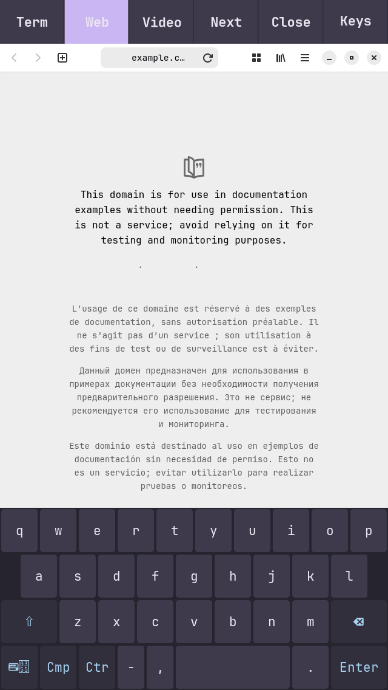

# a6-handheld-linux

Linux with a touch desktop on the iPhone 5 (Apple A6).



The phone boots Arch Linux ARM from RAM and runs a small desktop built for a
4-inch touch screen: the labwc compositor, the Foot terminal, the Epiphany
browser, an on-screen keyboard and a panel for switching apps. Touch, sound,
Wi-Fi and charging work. Both CPU cores are in use.

Nothing is installed on the phone. Every boot starts from a computer over USB
using the checkm8 bootrom exploit, and the phone's iOS installation is left
untouched. Power the phone off and it boots iOS as before.

This is experimental hardware work, not a daily driver. See
[known problems](#known-problems) before trying it.

The target is the iPhone5,2 (board N42AP, the GSM/CDMA model). Other iPhone 5
models have not been tried.

<br clear="right">

## What works

| Area | State |
| --- | --- |
| CPU | Both Swift cores run Linux (SMP). |
| Display | Software-rendered (Pixman). The screen blanks after two minutes idle and wakes on touch. |
| Touch | Multitouch through the stock touch controller firmware. |
| Keyboard | On-screen keyboard (wvkbd) with letter and number layouts. |
| Desktop | labwc, Foot, Epiphany and an app panel, in our own pastel theme. |
| Browser | Epiphany (WebKitGTK), sandboxed with bubblewrap and seccomp. Simple pages scroll and pinch-zoom. |
| Audio | Speaker and microphone through PipeWire. |
| Wi-Fi | The stock Linux `brcmfmac` driver over HSIC, with WPA2, DHCP and a default-deny firewall. |
| Charging | Charges from USB under a kernel policy with voltage, temperature and current limits, and shuts down at 3600 mV. |
| USB | Shell, networking and a root recovery channel over the cable. |
| Video | mpv plays H.264, but drops many frames because there is no GPU acceleration. |

Not working yet: GPU acceleration, backlight control, the battery fuel gauge,
suspend, Bluetooth, cameras, cellular, motion sensors and screen rotation.
[STATUS.md](STATUS.md) has the detail.

## How it boots

1. The host puts the phone into pwned DFU mode with the
   [checkm8](https://github.com/axi0mX/ipwndfu) bootrom exploit. This is a
   manual step and is not automated here.
2. The host loads Apple's iBSS and iBEC bootloaders, then a Linux kernel
   wrapped in the A6 kernelcache format with its device tree attached.
3. Linux starts from RAM. Over USB, the host sends a small network bootstrap.
   The phone joins Wi-Fi and downloads the signed, compressed desktop and
   browser images. If Wi-Fi fails within 60 seconds, it falls back to USB.
4. The phone checks the image signatures, mounts them with a writable RAM
   overlay, and starts the desktop as an unprivileged user.

The root filesystem lives in RAM, so nothing survives a power cycle.

## Building

The desktop and browser images build from pinned public sources and
signature-checked Arch Linux ARM packages. Two clean builds on the same host
produced byte-identical images.

```sh
python3 scripts/build-a6-handheld-from-source.py
```

The kernel and boot images need files you extract yourself from Apple's iOS
firmware for this phone (bootloaders, Wi-Fi firmware, touch firmware and
calibration). This repository does not include them, and that part of the
build has not yet been tried from a fresh checkout. [BUILDING.md](BUILDING.md)
covers both paths and the assisted boot.

## Known problems

- **Battery.** Linux drives the charger directly, and the cell in a phone this
  old is probably worn. Keep the built-in guards enabled. One night the phone
  discharged after the host lost contact with it, and the cause has not been
  found ([details](docs/test-results.md#power-and-battery)).
- **Wi-Fi stalls.** The connection sometimes stays associated but stops
  passing traffic. A health check detects this and restarts the Wi-Fi
  interface; this worked when it happened during testing. The cause is
  unknown.
- **USB stalls.** Large transfers from the phone to the host can stall, which
  is why large images go over Wi-Fi.
- **Video** drops frames, and the browser is only usable for simple pages.
- **Boot needs a computer** every time.

## Security

Desktop apps run as user 1000 with `no_new_privs`. The phone has no `sudo`,
and root access is only available over the USB cable. Wi-Fi refuses incoming
connections. Boot images are signed with Ed25519 and checked on the phone.
None of this has been audited.

## Documentation

- [STATUS.md](STATUS.md): hardware support, area by area
- [BUILDING.md](BUILDING.md): building images and booting the phone
- [docs/test-results.md](docs/test-results.md): hardware test results
- [docs/wifi-transport.md](docs/wifi-transport.md): how Wi-Fi works over HSIC on this phone
- [docs/charger-policy.md](docs/charger-policy.md): what the charger code does when monitoring stops
- [docs/usb-observation.md](docs/usb-observation.md): USB faults and how the tools handle them
- [docs/source-rebuild.md](docs/source-rebuild.md): reproducible desktop builds
- [desktop/theme/](desktop/theme/): the colour palette and app themes

## Thanks

This builds on the checkm8 exploit by axi0mX,
[checkm8_bootkit](https://github.com/NyanSatan/checkm8_bootkit) by NyanSatan,
[Legacy-iOS-Kit](https://github.com/LukeZGD/Legacy-iOS-Kit), libirecovery, Linux, Arch Linux ARM, labwc, wvkbd, Foot, WebKitGTK and PipeWire.
[Project Cascadia](https://github.com/rzxvx/Project-Cascadia), which runs Linux
on the A5 iPad mini, was a useful reference for Wi-Fi, SMP and touch.

## Licence

Original code and documentation are MIT. Linux-derived code and third-party
material keep their own licences. See [LICENSES.md](LICENSES.md).

Not affiliated with Apple. No warranty.
